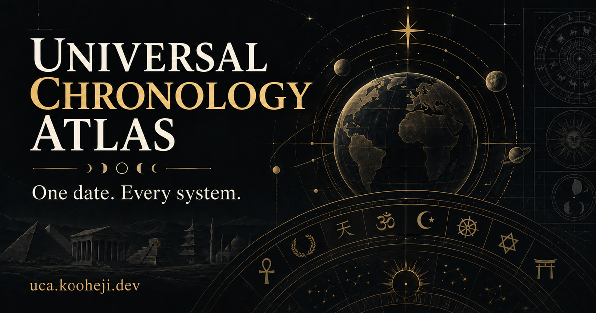

<div align="center">

# Universal Chronology Atlas

### One date. Every system.

Explore a single day across calendars, historical chronologies, astronomy, cultural traditions, and fictional universes.

[](https://github.com/kooheji/universal-date-atlas/actions/workflows/ci.yml)
[](https://uca.kooheji.dev/)
[](https://uca.kooheji.dev/)

[](https://uca.kooheji.dev/)

**[Open the live Atlas](https://uca.kooheji.dev/)** · **[Read the full documentation](App/README.md)**

</div>

## About

Universal Chronology Atlas is a framework-free interactive date explorer. Enter one Gregorian or Bahrain Hijri date and inspect how the same day is represented across systems created for different civil, religious, scientific, historical, cultural, and storytelling purposes.

The Atlas keeps those purposes distinct. Astronomical measurements are not presented as astrology, calculated Hijri dates are not presented as official observations, and reconstructed or project-synchronized fictional dates are labelled accordingly.

## Highlights

- Civil, religious, regional, historical, reconstructed, and traditional calendars
- ISO, Julian, Unix, GPS, Rata Die, historical eras, and continuous day counts
- Moon, Sun, planets, seasons, constellations, and sidereal-time calculations
- A Bahrain-focused Hijri model using the published Makkah conjunction-and-horizon criterion
- Cultural and symbolic traditions with clear evidence and interpretation labels
- Fictional chronologies with canonical, source-derived, reconstructed, and Atlas-defined mappings
- English and Arabic localization with complete right-to-left support
- Responsive light and dark interfaces with keyboard navigation
- Historical-year-safe UTC calculations, including CE years `0001`–`0099`

## Quick start

Requirements: Node.js 22 or another version supported by the current Vite release.

```bash
git clone https://github.com/kooheji/universal-date-atlas.git
cd universal-date-atlas/App
npm ci
npm run dev
```

Then open the local address printed by Vite.

## Test and build

```bash
cd App

# Engine and registry regression suites
npm test

# Production build
npm run build

# Responsive, keyboard, RTL, and axe browser checks
npx playwright install chromium
npm run test:browser
```

GitHub Actions runs the engine tests, production build, and Chromium browser suite on pushes and pull requests.

## Project structure

```text
.
├── App/
│   ├── public/              # Favicons, social preview, manifest, robots, sitemap
│   ├── src/
│   │   ├── assets/          # Original calendar and tradition artwork
│   │   ├── data/            # Calendar and fiction registries
│   │   ├── engine/          # Date, calendar, astronomy, culture, and fiction logic
│   │   ├── ui/              # Symbols and optional WebGL artwork
│   │   └── main.js          # Application coordination and rendering
│   ├── tests/               # Production-browser regression tests
│   └── README.md            # Detailed methodology and feature documentation
└── .github/workflows/ci.yml
```

## Accuracy and scope

Not every result has the same authority. The interface distinguishes standard conversions, astronomical models, historical reconstructions, cultural interpretations, source-derived fictional systems, and explicit Atlas conventions.

Date-only astronomy is evaluated at **12:00 UTC**. Optional time input is UTC. Observer-dependent calculations accept **latitude and longitude coordinates**, not city names.

Calculated Hijri results are computational models. Official lunar observations may supersede them.

## Methodology and sources

See [Methodology and sources](docs/SOURCES.md) for the provenance model, evidence levels, implementation assumptions, source catalogue, and the explicit research backlog. The catalogue distinguishes standards, official calendars, astronomical models, historical reconstructions, cultural interpretations, and Atlas synchronization conventions.

## Contributing

Corrections, stronger historical sources, accessibility improvements, additional tests, and carefully documented calendar implementations are welcome. Please include references and regression cases with any conversion change.

## Licensing status

This repository does not yet include a project license. Public source access does not by itself grant reuse rights. Before licensing, the project owner should confirm ownership and permitted use of the original code, SVG artwork, icons, social assets, and fictional-universe references.

See [the open-source readiness review](App/OPEN_SOURCE_REVIEW.md) for the recommended checklist. No rights to third-party artwork, names, or trademarks should be assumed.

